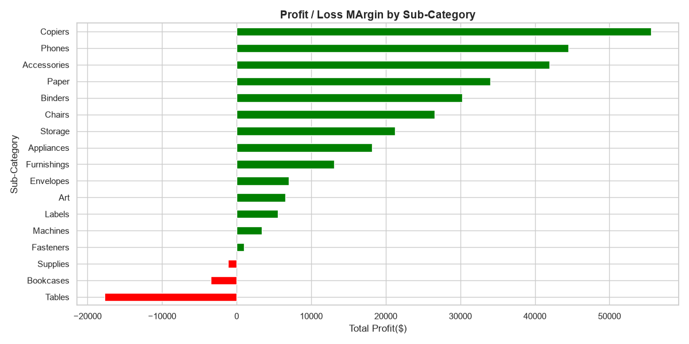
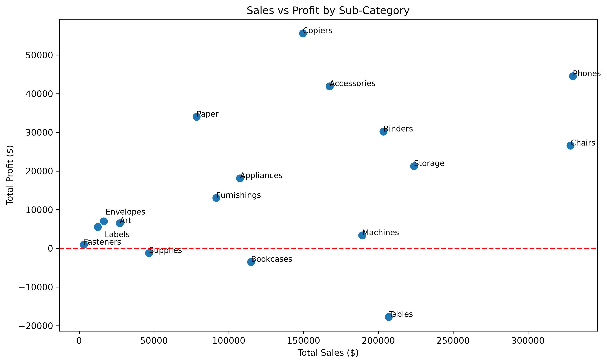
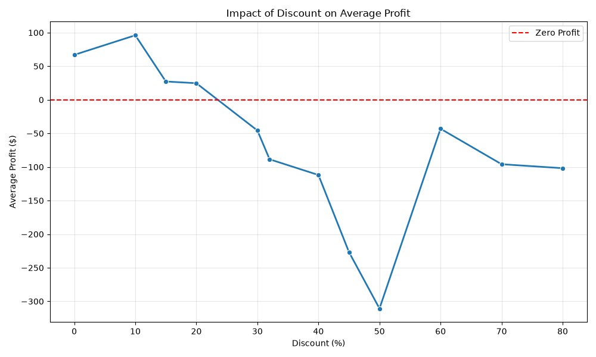
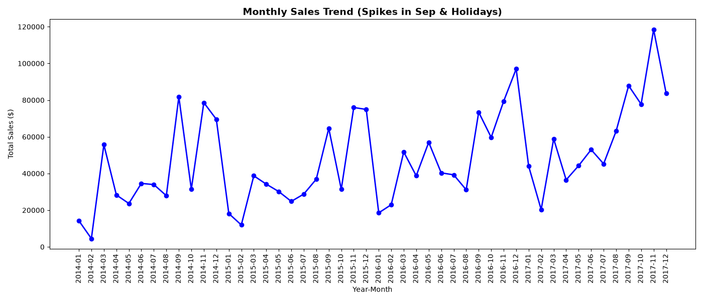
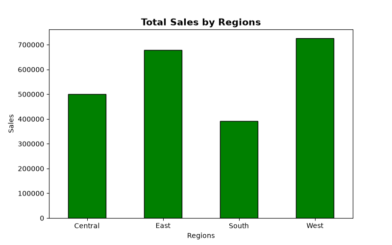
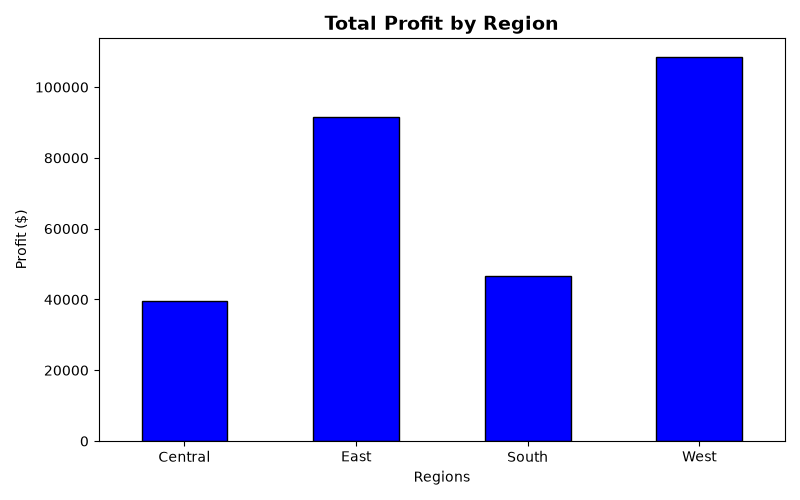
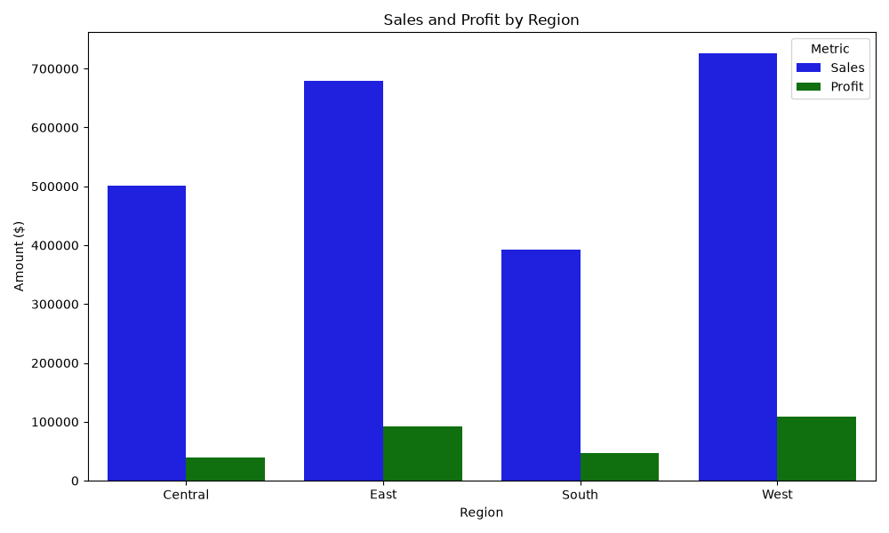
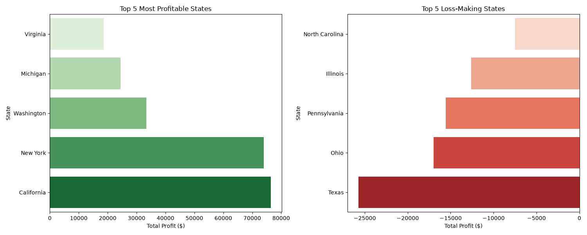
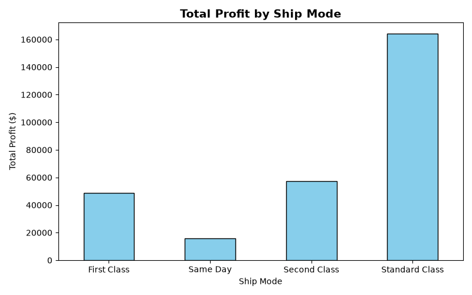

# Superstore Sales & Profit Analysis

## Project Overview

This project explores the Superstore retail dataset using Python to analyze sales performance and profitability across product categories, sub-categories, discount levels, regions, states, and shipping methods.

The objective is to identify business trends, investigate loss-making areas, and generate actionable insights through data analysis and visualization.

## Objectives

- Analyze total sales and profit across product categories and sub-categories.
- Investigate the relationship between discount levels and average profit.
- Compare sales and profitability across regions and states.
- Examine monthly sales trends.
- Evaluate profit contribution across shipping methods.
- Present findings through clear and informative visualizations.

## Tools & Technologies

- **Python**
- **Pandas** — data manipulation and aggregation
- **NumPy** — numerical computing
- **Matplotlib** — data visualization
- **Seaborn** — statistical visualization
- **Jupyter Notebook** — interactive analysis

## Dataset

The dataset contains **9,994 records and 21 columns**, including order dates, customer details, product categories, geographic information, sales, quantity, discount, and profit.

The initial data-quality checks found:
- No missing values across the dataset.
- No exact duplicate rows.
- No negative sales values.
- 1,871 records with negative profit.

## Key Findings

### 1. Category Performance

Technology generated the highest total profit, followed by Office Supplies. Furniture contributed the least profit among the three categories.

### 2. Sub-Category Profitability

Tables and Bookcases generated negative total profit, highlighting areas that require further investigation.

### 3. Discount Analysis

Higher discount levels were associated with lower average profit in the dataset. This relationship indicates an area for further investigation and does not establish that discounts alone caused the lower profits.

### 4. Regional Performance

The West Region generated the highest total sales (**$725,457.82**) and profit (**$108,418.45**). The Central Region generated more sales than the South Region but less total profit.

### 5. State-wise Performance

- **California:** Highest total profit at $76,381.39.
- **New York:** Second-highest total profit at $74,038.55.
- **Texas:** Largest total loss at -$25,729.36.
- Ohio and Pennsylvania also recorded substantial total losses.

### 6. Monthly Sales Trends

Monthly sales fluctuated over time, providing useful context for inventory planning, marketing decisions, and resource allocation.

### 7. Shipping Method Analysis

Standard Class generated the highest total profit among the shipping methods. Further analysis of order volume and average profit per order would help evaluate shipping-method performance more comprehensively.

## Business Recommendations

- Investigate loss-making sub-categories, particularly Tables and Bookcases.
- Review discount policies alongside profit margins and order-level performance.
- Investigate loss-making states, especially Texas, Ohio, and Pennsylvania.
- Study the West Region's product mix and sales performance to identify potentially useful practices.
- Use monthly sales trends to support inventory and marketing planning.
- Compare shipping methods using order volume and average profit per order.

## Project Structure

```text
superstore-sales-profit-analysis/
├── Superstore_Sales_Profit_Analysis.ipynb
├── superstore_analysis.py
├── superstore.xlsx
├── images/
└── README.md
```

## How to Run

1. Clone or download this repository.
2. Install the required libraries:

   ```bash
   pip install pandas numpy matplotlib seaborn openpyxl jupyter ipython
   ```

3. Open `Superstore_Sales_Profit_Analysis.ipynb` in Jupyter Notebook or VS Code.
4. Ensure the dataset is available at the path used in the notebook.
5. Run the cells from top to bottom to reproduce the analysis and visualizations.

## Limitations

This project focuses on descriptive analysis. Observed relationships, such as the relationship between discounts and profit, do not establish causation. Further investigation using profit margins, order-level analysis, and additional business context would be required before implementing major business decisions.

## Conclusion

This project demonstrates practical skills in data cleaning checks, data aggregation, exploratory data analysis, trend analysis, and visualization using Python. It also illustrates how analytical findings can be translated into business questions and recommendations.

---

**Project:** Superstore Sales & Profit Analysis  
**Focus:** Data Analysis | Business Insights | Data Visualization

## Visualizations

### 1. Sub-Category Profit and Loss



### 2. Sales vs Profit by Sub-Category



### 3. Discount Analysis



### 4. Monthly Sales Trend



### 5. Regional Sales



### 6. Regional Profit



### 7. Regional Sales vs Profit



### 8. State-wise Profitability



### 9. Ship Mode Profit

